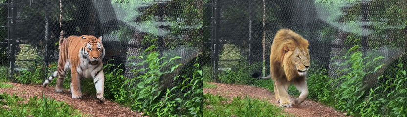
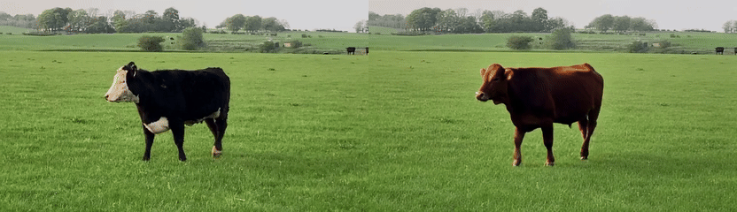
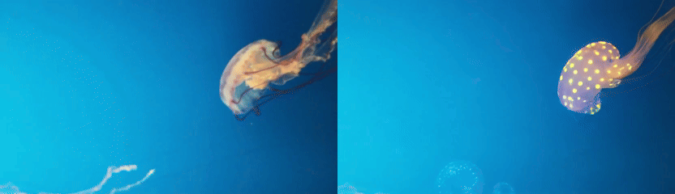
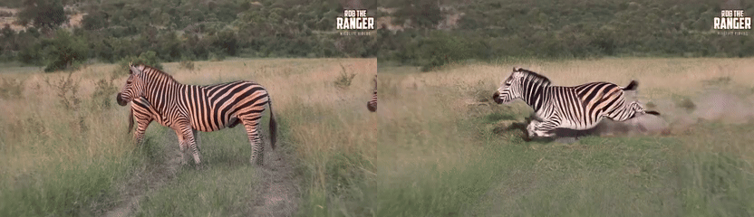

<div align="center">

<h1>AR-Edit: Training-Free Autoregressive Video Editing <br> without Inversion</h1>

<div>
  <a href="https://marghovo.github.io" target="_blank">Hovhannes Margaryan</a><sup>1, 3</sup>,
  <a href="https://scholar.google.com/citations?user=gLEhMQQAAAAJ" target="_blank">Quentin Bammey</a><sup>2</sup>,
  <a href="https://scholar.google.com/citations?user=88vBLhsAAAAJ" target="_blank">Christian Sandor</a><sup>1</sup>,
  <a href="https://scholar.google.com/citations?user=gIRvhKkAAAAJ" target="_blank">Vicky Kalogeiton</a><sup>3</sup>
</div>

<br>

<div>
  <sup>1</sup>Team ARAI, Université Paris-Saclay, CNRS, LISN<br>
  <sup>2</sup>LTCI, Télécom Paris, Institut Polytechnique de Paris<br>
  <sup>3</sup>LIX, École Polytechnique, CNRS, Institut Polytechnique de Paris
</div>

<br>

<b>NeurIPS 2026</b>

[](#)
[](https://marghovo.github.io/AR-Edit/)
[](#)

</div>

<table>
  <tr>
    <td align="center"><br>
      Object swapping: a <u>tiger</u> walks through its enclosure &rarr; a <u>lion</u> walks through its enclosure</td>
    <td align="center"><br>
      Content change: <u>black-and-white spotted</u> cow &rarr; <u>solid ginger-brown</u> cow</td>
  </tr>
  <tr>
    <td align="center"><br>
      Content change: <u>translucent</u> jellyfish &rarr; jellyfish <u>covered in glowing neon polka-dot patterns</u></td>
    <td align="center"><br>
      Motion modification: a zebra <u>standing still</u> in a grassy field &rarr; a zebra <u>sprinting at full speed</u> through a grassy field</td>
  </tr>
</table>

## 🎯 Overview

> **TL;DR**: In DMD-distilled autoregressive video diffusion models, queries and
> keys stay aligned with their clean-source counterparts across denoising
> timesteps, while values diverge: the attention routing is preserved and the
> generated content is carried by the values. AR-Edit caches the source's values
> from a single clean forward pass and injects them while each chunk is denoised
> from pure noise. This gives real-time, structure-preserving streaming video
> editing with no optimization, inversion or training.

## 📋 Table of Contents

- [Abstract](#-abstract)
- [Requirements](#-requirements)
- [Installation](#-installation)
- [Pretrained Checkpoints](#-pretrained-checkpoints)
- [Inference](#-inference)
- [Benchmark](#-benchmark)
- [Citation](#-citation)
- [Acknowledgements](#-acknowledgements)
- [License](#-license)

## 📝 Abstract

Editing a video stream in real time, without access to future frames, is essential for interactive applications. Existing training-free video editing methods, however, assume full offline access to the entire sequence, while streaming approaches either rely on additional training or are limited to specific editing techniques. We show that this limitation can be removed by analyzing the self-attention dynamics of DMD-distilled autoregressive (AR) video diffusion models. We uncover a key asymmetry: queries and keys remain stable and aligned with their source counterparts across denoising timesteps, while values diverge and encode the evolving content. Inherited from the non-distilled bidirectional teacher, this asymmetry is strongest at high noise, where few-step streaming models operate. The resulting mechanism is simple: a single forward pass suffices to capture source identity in the value features, which can be reused throughout generation. Starting from pure Gaussian noise and injecting only these source values reconstructs the input with fidelity matching or surpassing inversion-based methods, effectively eliminating inversion. Based on this insight, we introduce AR-Edit, a training-free, inversion-free method that caches source values once and selectively injects them during denoising. Across multiple AR backbones, AR-Edit enables real-time streaming editing with superior source preservation and tonal fidelity at minimal overhead.

## 🔧 Requirements

- GPU: NVIDIA GPU with at least 24 GB of memory (the text encoder is swapped
  to CPU automatically below 40 GB).
- Linux, Python 3.10. Tested with PyTorch 2.5 / CUDA 12.1 on a single H100.

## 🛠️ Installation

```bash
git clone https://github.com/marghovo/AR-Edit.git
cd AR-Edit
conda create -n aredit python=3.10 -y && conda activate aredit
pip install -r requirements.txt
pip install flash-attn --no-build-isolation      # FlashAttention-2 (or -3 on Hopper)
```

## 📦 Pretrained Checkpoints

AR-Edit runs on the released
[Reward-Forcing](https://github.com/JaydenLyh/Reward-Forcing) T2V-1.3B
generator (a 4-step autoregressive student of Wan2.1) and needs no training.

```bash
bash download_checkpoints.sh
```

downloads the two required checkpoints into `checkpoints/`:

```
checkpoints/
├── Wan2.1-T2V-1.3B/              # UMT5 text encoder, VAE, DiT config (Wan-AI/Wan2.1-T2V-1.3B)
└── Reward-Forcing-T2V-1.3B/
    └── rewardforcing.pt          # 4-step generator (JaydenLu666/Reward-Forcing-T2V-1.3B)
```

If the Wan2.1 folder lives elsewhere, pass its parent directory with
`--wan_checkpoint_dir`.

## 🚀 Inference

### Edit a video

```bash
python inference_aredit.py \
    --checkpoint_path checkpoints/Reward-Forcing-T2V-1.3B/rewardforcing.pt \
    --wan_checkpoint_dir checkpoints \
    --video_path my_video.mp4 \
    --src_prompt "A zebra walks across the savanna." \
    --tar_prompt "A horse walks across the savanna." \
    --output_folder outputs
```

or `bash scripts/run_single.sh my_video.mp4 "<source prompt>" "<target prompt>"`.
Prompts can also come from text files (`--src_prompt_file`, `--tar_prompt_file`,
first non-empty line). The input is resized to 832x480 and the first 81 frames
are used (`--num_frames`, must be 1 + 4k; 81 frames = 7 chunks).

The source prompt matters: the text boost and the edit mask are derived from
the words that differ between the two prompts, so describe the input video
faithfully and change only what should change.

Outputs go to `outputs/<video_name>/`:

```
output.mp4       edited video
input.mp4        resized input (same length)
compare.mp4      input | AR-Edit side by side
run_args.json    every flag of the run
```

### Choosing the mask combination

| `--cta_combine` | `--edit_type` | Use for |
|---|---|---|
| `union` (default) | from the task | local edits: object swapping / insertion, attributes, motion |
| `union` | `change` | style changes (anchor kept on) |
| `hadamard` | `change` | global scene transformations (weather, season, time of day) |
| `kept_inv` | from the task | background swaps: anchor only the silhouette of the kept words |

`--edit_type style` disables the anchor entirely (commit only).

### Flags (defaults = the AR-Edit recipe)

| Flag | Paper | Default | Meaning |
|---|:-:|:-:|---|
| `--inject_step` | *S* | 2 | denoising steps `[0, S)` receive the full source values (commit) |
| `--late_anchor_start` | *S*<sub>CtA</sub> | 2 | first step at which the edit mask confines the injection (anchor); `--no_anchor` disables it |
| `--v_inject_min_block` | *b*<sub>min</sub> | 22 | blocks `> b_min` (i.e. 23-29) receive the source values |
| `--cta_block_max` | *b*<sub>CtA</sub> | 19 | the edit mask is read from the cross-attention of blocks 1 to `b_CtA` |
| `--text_scale` | *s* | 4.0 | attention boost of the target-only words (1.0 = off) |

`python inference_aredit.py --help` lists the remaining flags (mask
post-processing, blend weights, `--seed`, `--cta_save_masks`).

### From Python

```python
import torch
from omegaconf import OmegaConf
from aredit import AREditConfig, AREditRunner

backbone = OmegaConf.load("configs/aredit_reward_forcing.yaml")
backbone.checkpoint_path = "checkpoints"                      # dir containing Wan2.1-T2V-1.3B/
runner = AREditRunner(backbone, AREditConfig(cta_combine="union"), torch.device("cuda"))
runner.load_weights("checkpoints/Reward-Forcing-T2V-1.3B/rewardforcing.pt")
runner.to_device(low_memory=False)
runner.set_prompts(src_prompt, tar_prompt)                    # prompt alignment -> text boost + mask tokens
video = runner.edit(input_video, src_prompt, tar_prompt)      # [1, C, T, H, W] in [-1, 1] -> [T, H, W, C] in [0, 1]
```

## 📊 Benchmark

The benchmark is 120 hand-curated Pexels videos in ten edit categories, each
with a source caption, a target prompt and an edit-region mask:
[download](#).

`scripts/run_pexels_benchmark.sh` runs one clip per SLURM array task from a
JSON file (fields `id`, `video_path`, `caption`, `target_prompt`,
`edit_type`, `category`) and applies the per-category routing of the mask
combination table above:

```bash
export BENCH_JSON=/path/to/bench.json OUT_DIR=outputs/bench CKPT_DIR=checkpoints
sbatch --array=0-119 scripts/run_pexels_benchmark.sh          # or: CLIP_IDX=3 bash scripts/run_pexels_benchmark.sh
```

### Tonal Fidelity (TF, TF-u)

Tonal Fidelity (TF). Measures whether an edit preserves the tonal distribution of its source, i.e. whether it introduces burning or overexposure artifacts. The histogram of the edited video is compared with that of the source by the KL divergence and mapped to [0, 1], as defined in Eq. (3) of the paper; values near 1 mean the tonal distribution is preserved. TF uses the whole frame. TF_u restricts both histograms to the region the edit is not supposed to change, given a per-clip edit-mask video.

```bash
python scripts/eval_tonal_fidelity.py --source input.mp4 --edited output.mp4                 # TF
python scripts/eval_tonal_fidelity.py --source input.mp4 --edited output.mp4 \
       --mask mask.mp4 --category change_attribute_color                                     # TF + TF-u
python scripts/eval_tonal_fidelity.py ... --json     # {kl, tf[, kl_u, tf_u, region, category]}
```

## 📚 Citation

```bibtex
@inproceedings{margaryan2026aredit,
  title     = {{AR-Edit}: Training-Free Autoregressive Video Editing without Inversion},
  author    = {Margaryan, Hovhannes and Bammey, Quentin and Sandor, Christian and Kalogeiton, Vicky},
  booktitle = {Advances in Neural Information Processing Systems},
  year      = {2026}
}
```

## 🙏 Acknowledgements

AR-Edit is built on [Reward-Forcing](https://github.com/JaydenLyh/Reward-Forcing),
[CausVid](https://github.com/tianweiy/CausVid),
[Self Forcing](https://github.com/guandeh17/Self-Forcing),
[RF-Solver-Edit](https://github.com/wangjiangshan0725/RF-Solver-Edit),
[ReFlex](https://github.com/wlaud1001/ReFlex),
[DiTCtrl](https://github.com/TencentARC/DiTCtrl) and
[ProEdit](https://arxiv.org/abs/2512.22118). The implementation relies on
[PyTorch](https://pytorch.org), [Diffusers](https://github.com/huggingface/diffusers),
[Transformers](https://github.com/huggingface/transformers),
[FlashAttention](https://github.com/Dao-AILab/flash-attention) and other
open-source libraries. We thank the authors for their great work and open-source contributions. 

Source videos of the benchmark come from
[Pexels](https://www.pexels.com) and are used under the Pexels License.


## 📜 License

Apache-2.0, as Reward-Forcing (see `LICENSE`). The Wan2.1 and Reward-Forcing
weights keep their own licenses.
